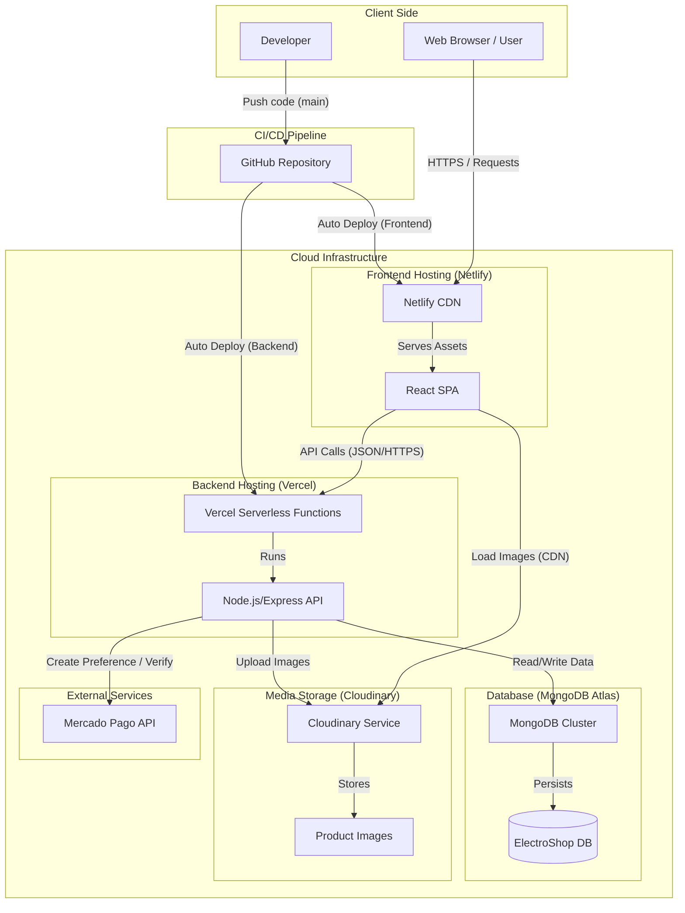

# ElectroShop - Plataforma de E-commerce

Plataforma web moderna para la compra y reserva de electrodomésticos con retiro en tienda. Desarrollada con una arquitectura separada (Frontend y Backend) y lista para despliegue en la nube.

## Tecnologías

### Backend
- **Node.js & Express**: Servidor API RESTful.
- **TypeScript**: Para tipado.
- **MongoDB & Mongoose**: Base de datos NoSQL.
- **Jest & Supertest**: Pruebas unitarias y de integración.
- **MercadoPago**: Integración de pasarela de pagos.

### Frontend
- **React**: Biblioteca de UI.
- **Vite**: Empaquetador rápido.
- **Context API**: Gestión de estado global (Auth, Cart).
- **Playwright**: Pruebas E2E y de usabilidad.

### Herramientas de Calidad
- **JMeter**: Pruebas de performance y carga.
- **Swagger**: Documentación de API (en `docs/`).

---
## Arquitectura y Buenas Prácticas

### Patrones de Arquitectura
El proyecto sigue una **Arquitectura en Capas (Layered Architecture)** para garantizar la separación de responsabilidades y la mantenibilidad:

1.  **Presentation Layer (Routes & Controllers)**: Maneja las peticiones HTTP y la validación de entrada.
2.  **Service Layer (Services)**: Contiene toda la lógica de negocio pura, desacoplada de la capa HTTP.
3.  **Data Access Layer (Models)**: Interactúa con la base de datos MongoDB usando Mongoose.

### Patrones de Diseño Implementados

#### 1. Singleton
Garantiza que exista una única instancia de la conexión a la base de datos en toda la aplicación.
- **Implementación**: Clase `Database` en `backend/src/config/database.ts`.
- **Beneficio**: Optimiza el manejo de conexiones a MongoDB.

#### 2. Observer
Permite definir un mecanismo de suscripción para notificar a múltiples objetos sobre eventos que suceden en el sistema.
- **Implementación**: Interfaces `Subject` y `Observer` en `backend/src/utils/Observer.ts`.
- **Uso**: `ProductService` notifica a `LoggingObserver` cada vez que se crea, actualiza o elimina un producto.
- **Beneficio**: Desacopla la lógica de negocio de las tareas secundarias como el logging o notificaciones.

#### 3. Factory (Simple Factory)
Centraliza la creación de respuestas estandarizadas de la API.
- **Implementación**: `ApiResponseFactory` en `backend/src/utils/ApiResponseFactory.ts`.
- **Beneficio**: Mantiene consistencia en el formato de las respuestas JSON (`success`, `data`, `message`) en toda la API.

### Buenas Prácticas
- **Clean Code**: Uso de nombres descriptivos, funciones pequeñas y principios SOLID.
- **Manejo de Errores**: Bloques try-catch en controladores y servicios para evitar caídas del servidor.
- **Variables de Entorno**: Configuración sensible separada en archivos `.env`.
- **Tipado Estático**: Uso extensivo de TypeScript para prevenir errores en tiempo de compilación.

---
## Estructura del Proyecto

```
/
├── backend/                 # API REST (Express + TS)
│   ├── src/
│   │   ├── controllers/     # Lógica de controladores
│   │   ├── models/          # Modelos Mongoose
│   │   ├── routes/          # Definición de rutas
│   │   ├── services/        # Lógica de negocio
│   │   └── app.ts           # Punto de entrada
│   └── tests/               # Pruebas unitarias
├── web-app/                 # Frontend (React + Vite)
│   ├── src/
│   │   ├── components/      # Componentes reutilizables
│   │   ├── context/         # Estado global
│   │   └── pages/           # Vistas principales
├── tests/                   # Pruebas del Sistema
│   ├── acceptance-test/     # Pruebas de aceptación de API
│   ├── e2e/                 # Pruebas de usabilidad (Playwright)
│   └── performance-test/    # Pruebas de performance (JMeter)
└── docs/                    # Documentación (Swagger)
```

---

## Configuración e Instalación

### Prerrequisitos
- Node.js (v16 o superior)
- MongoDB (Local o Atlas)
- Apache JMeter (para pruebas de performance)

### 1. Configuración del Backend

1. Navega a la carpeta `backend`:
   ```bash
   cd backend
   ```
2. Instala las dependencias:
   ```bash
   npm install
   ```
3. Configura las variables de entorno:
   Crea un archivo `.env` basado en `.env.example`:
   ```env
   PORT=3000
   MONGO_URI=mongodb://127.0.0.1:27017/electroshop
   JWT_SECRET=un_secreto_para_jwt
   MERCADOPAGO_ACCESS_TOKEN=token_de_prueba_o_produccion
   FRONTEND_URL=http://localhost:5173
   ```
4. Inicializa la base de datos (admin):
   ```bash
   npm run db:init
   ```
   *Esto creará un usuario Admin y productos de prueba.*

### 2. Configuración del Frontend

1. Navega a la carpeta `web-app`:
   ```bash
   cd web-app
   ```
2. Instala las dependencias:
   ```bash
   npm install
   ```
3. Configura las variables de entorno:
   Crea un archivo `.env` basado en `.env.example`:
   ```env
   VITE_API_URL=http://localhost:3000
   ```

---

## Ejecución

### Modo Desarrollo

**Backend:**
```bash
cd backend
npm run dev
```
*El servidor iniciará en http://localhost:3000*

**Frontend:**
```bash
cd web-app
npm run dev
```
*La aplicación iniciará en http://localhost:5173*

---

## Ejecución de Pruebas

El proyecto cuenta con una estrategia de pruebas completa:

### 1. Pruebas Unitarias (Backend - Frontend)
Verifican la lógica aislada de los servicios.
```bash
cd backend
npm test
```

```bash
cd web-app
npm test
```


### 2. Pruebas de Aceptación (API)
Verifican los flujos de negocio completos a nivel de API (Registro -> Login -> Carrito -> Checkout).
```bash
cd tests/acceptance-test
npm test
```

### 3. Pruebas E2E / Usabilidad (Frontend)
Simulan la interacción real de un usuario en el navegador usando Playwright.
*Requiere que el Frontend y Backend estén corriendo.*
```bash
cd tests/e2e
npx playwright test
```
Para ver el reporte:
```bash
npx playwright show-report
```

### 4. Pruebas de Performance (JMeter)
Pruebas de carga para verificar tiempos de respuesta bajo estrés.
*Requiere JMeter instalado y en el PATH.*
```bash
# Desde la raíz del proyecto
jmeter -n -t tests/performance-test/load-test.jmx -l tests/performance-test/results.jtl -e -o tests/performance-test/report
```

---

## Despliegue

La aplicación está preparada para despliegue en la nube (Vercel, Netlify).

**Consideraciones:**
- Asegúrate de configurar las variables de entorno (`FRONTEND_URL`, `BACKEND_URL`, `VITE_API_URL`) en el panel de control de tu proveedor de nube.
- El backend utiliza CORS dinámico para permitir peticiones solo desde el dominio del frontend configurado.

### Diagrama de Despliegue



---

## Autores
- Jhon Sánchez
